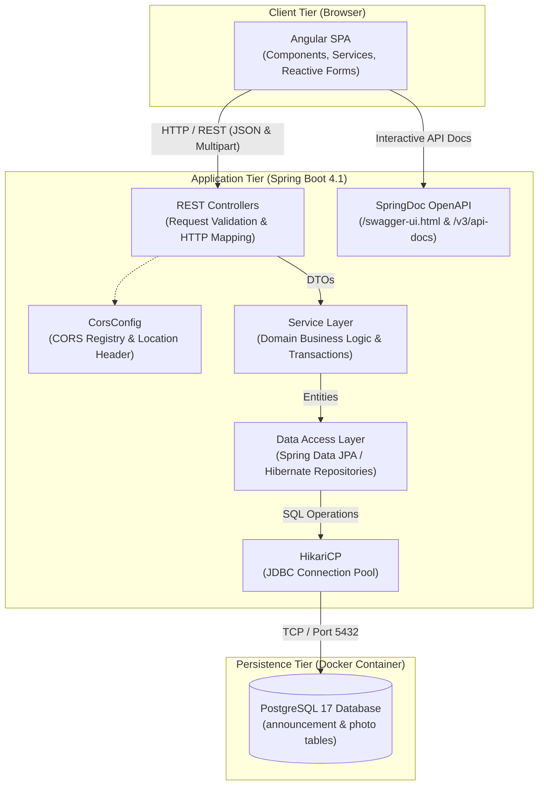
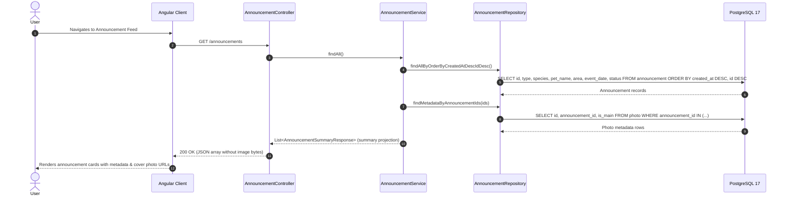
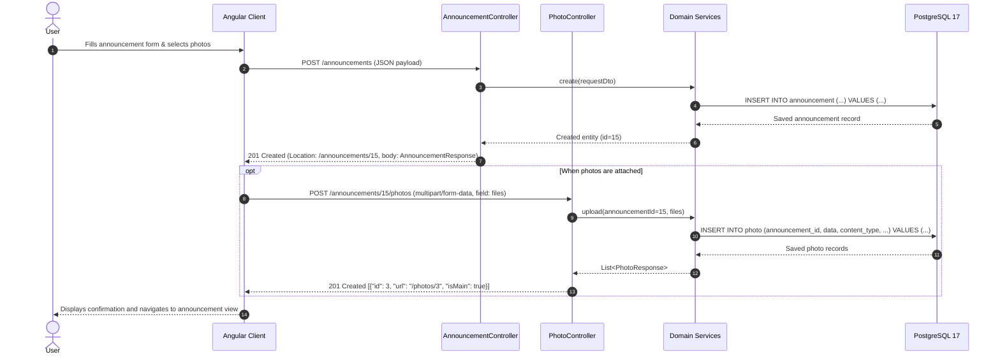

# System Architecture

## 1. System Overview
SafePaws is a collaborative web-based platform designed to assist pet owners and communities in tracking, reporting, and reuniting lost and found pets.

---

## 2. High-Level Architecture
The system follows a decoupled client-server multi-tier architecture:
- **Client Tier:** Angular Single Page Application (SPA) communicating via RESTful JSON over HTTP/HTTPS.
- **Application Tier:** Spring Boot REST API handling business logic, validation, transaction management, and OpenAPI documentation.
- **Persistence Tier:** PostgreSQL 17 database containerized via Docker Compose, managed via Spring Data JPA, Hibernate, and Flyway.

---

## 3. Component Communication & Tier Architecture

The diagram below illustrates the end-to-end communication flow across all system tiers:



---

## 4. End-to-End Data Flow Scenarios

### Scenario 1: Listing Announcements


*Key Characteristic:* Heavy raw image bytes (`BYTEA`) and lengthy details (`breed`, `color`, `distinctiveMarks`, coordinates, contact details) are omitted from `GET /announcements`. Images are loaded on demand via `/photos/{id}`.

---

### Scenario 2: Uploading Announcement & Attached Photos


---

## 5. Repository & Module Structure

The project structure cleanly separates client, server, database migrations, and documentation:

```text
safepaws/
├── backend/                              # Spring Boot (Java 21)
│   ├── src/main/java/.../safepaws/
│   │   ├── controller/                   # REST Endpoints (AnnouncementController, PhotoController)
│   │   ├── service/                      # Business & application logic (AnnouncementService, PhotoService)
│   │   ├── repository/                   # Spring Data JPA database access & projections
│   │   ├── model/                        # JPA Entities (Announcement, Photo, Enums)
│   │   ├── dto/                          # API Request/Response Transfer Objects
│   │   ├── exception/                    # Global exception handling & custom errors
│   │   └── config/                       # Configuration beans (CorsConfig, etc.)
│   ├── src/main/resources/
│   │   ├── application.properties        # Application configuration settings & .env import
│   │   └── db/migration/                 # Flyway SQL versioned migrations (V1, V2)
│   └── src/test/                         # Tests mirroring src/main structure (JUnit 5, Mockito, Testcontainers)
├── frontend/                             # Angular 22 SPA
│   └── src/
│       ├── app/
│       │   ├── pages/                    # Views/pages (AnnouncementList, AnnouncementForm)
│       │   ├── components/               # Reusable UI elements (AnnouncementCard, Header)
│       │   ├── services/                 # HTTP services calling the backend
│       │   └── models/                   # TypeScript interfaces (Announcement, Photo)
│       └── environments/                 # Backend API base URL configuration
├── docs/                                 # Project documentation
├── docker-compose.yml                    # Starts PostgreSQL 17 database
└── README.md                             # Project overview
```

---

## 6. Infrastructure & Quality Pipeline

### Cross-Origin Resource Sharing (CORS)
- Handled by `CorsConfig` allowing origins configured via `CORS_ALLOWED_ORIGINS` (defaulting to `http://localhost:4200`).
- Supports methods `GET, POST, PUT, PATCH, DELETE, OPTIONS`, allows all headers, and exposes the `Location` header so clients can retrieve newly created resource URLs.

### Interactive API Documentation
- Powered by `springdoc-openapi-starter-webmvc-ui` (v3.1.1).
- Interactive Swagger UI: `http://localhost:8080/swagger-ui.html`
- OpenAPI Specification: `http://localhost:8080/v3/api-docs`

### CI/CD Automation (GitHub Actions)
Continuous integration is configured under `.github/workflows/ci.yml` and triggers on pushes and PRs to `main`:
1. **Backend Verification:** Uses Temurin JDK 21, executes `./mvnw verify` with Testcontainers starting a real PostgreSQL container, and checks that JaCoCo instruction coverage is >= 70%.
2. **Frontend Verification:** Uses Node 22, installs dependencies via `npm ci`, runs tests with Vitest (`npm run test:coverage`), checks statement/branch/function coverage >= 70%, and performs a production build (`npm run build`).
3. **Secret Scan:** Scans commit diffs with Gitleaks (v8.21.2) to prevent accidental credential commits.
4. **Migration Guard:** Validates that Flyway migrations on `main` are immutable, version numbers are unique, and new migrations contain no destructive DDL unless explicitly marked `[destructive]` in the PR title.

---

## 7. Security & Authentication
- **Milestone 1 (Demo 1):** Unauthenticated open submission with contact details stored directly on announcement records.
- **Milestone 2 (Target):** Stateless token-based authentication using Spring Security and JWT; role-based authorization for administrative vs. regular user capabilities.
