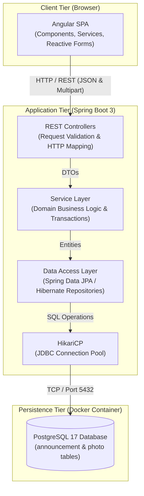
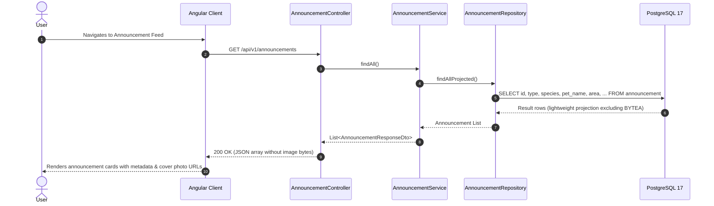
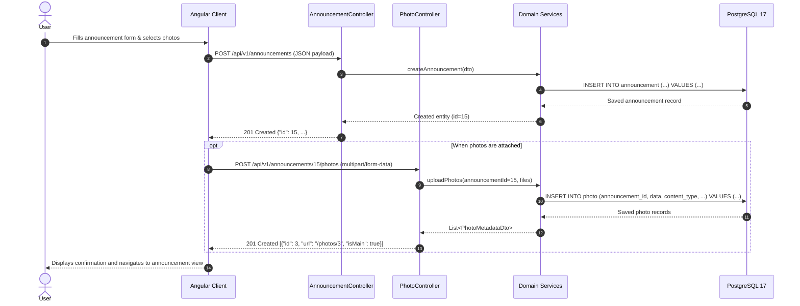

# System Architecture

## 1. System Overview
SafePaws is a collaborative web-based platform designed to assist pet owners and communities in tracking, reporting, and reuniting lost pets, as well as managing adoption announcements.

---

## 2. High-Level Architecture
The system follows a decoupled client-server multi-tier architecture:
- **Client Tier:** Angular Single Page Application (SPA) communicating via RESTful JSON over HTTP/HTTPS.
- **Application Tier:** Spring Boot REST API handling business logic, validation, and transactions.
- **Persistence Tier:** PostgreSQL database managed via Spring Data JPA, Hibernate, and Flyway.

---

## 3. Component Communication & Tier Architecture

The diagram below illustrates the end-to-end communication flow across all system tiers:



---

## 4. End-to-End Data Flow Scenarios

### Scenario 1: Listing Announcements


*Key Characteristic:* Heavy raw image bytes (`BYTEA`) are explicitly omitted during list queries. Images are only loaded individually on demand via `/photos/{id}`.

---

### Scenario 2: Uploading Announcement & Attached Photos


---

## 5. Repository & Module Structure

The project structure cleanly separates client, server, database migrations, and documentation:

```text
safepaws/
├── backend/                              # Spring Boot (Java)
│   ├── src/main/java/.../safepaws/
│   │   ├── controller/                   # REST Endpoints
│   │   ├── service/                      # Business & application logic
│   │   ├── repository/                   # Spring Data JPA database access
│   │   ├── model/                        # JPA Entities (Announcement, Photo)
│   │   ├── dto/                          # API Request/Response Transfer Objects
│   │   ├── exception/                    # Global exception handling & custom errors
│   │   └── config/                       # Configuration beans (Swagger, CORS, etc.)
│   ├── src/main/resources/
│   │   ├── application.properties        # Application configuration settings
│   │   └── db/migration/                 # Flyway SQL versioned migrations
│   └── src/test/                         # Tests mirroring src/main structure
├── frontend/                             # Angular SPA
│   └── src/
│       ├── app/
│       │   ├── pages/                    # Views/pages (List, Form)
│       │   ├── components/               # Reusable UI elements (Announcement Card, etc.)
│       │   ├── services/                 # HTTP services calling the backend
│       │   ├── models/                   # TypeScript interfaces (Announcement, Photo)
│       │   └── shared/                   # Shared components, directives, pipes
│       └── environments/                 # Environment configuration (Backend API URLs)
├── docs/                                 # Project documentation
├── docker-compose.yml                    # Starts PostgreSQL 17 database
└── README.md                             # Project overview
```

---

## 6. Security & Authentication
- **Milestone 1 (Demo 1):** Unauthenticated open submission with contact details stored directly on announcement records.
- **Milestone 2 (Target):** Stateless token-based authentication using Spring Security and JWT; role-based authorization for administrative vs. regular user capabilities.
