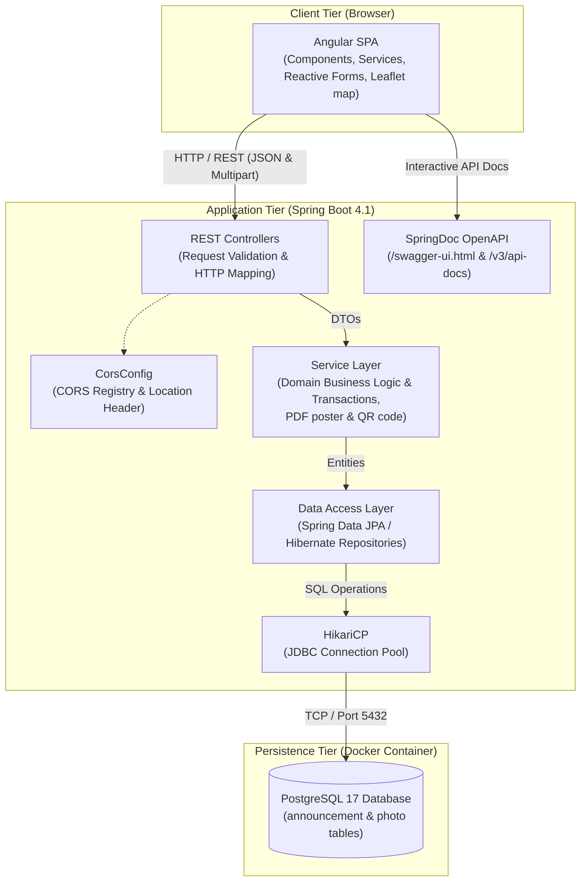
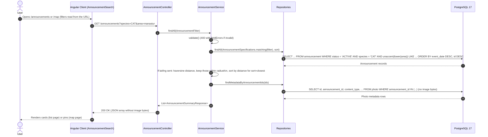
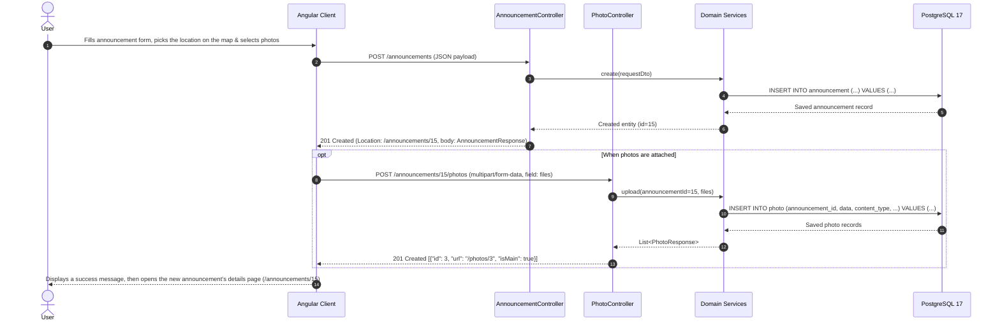
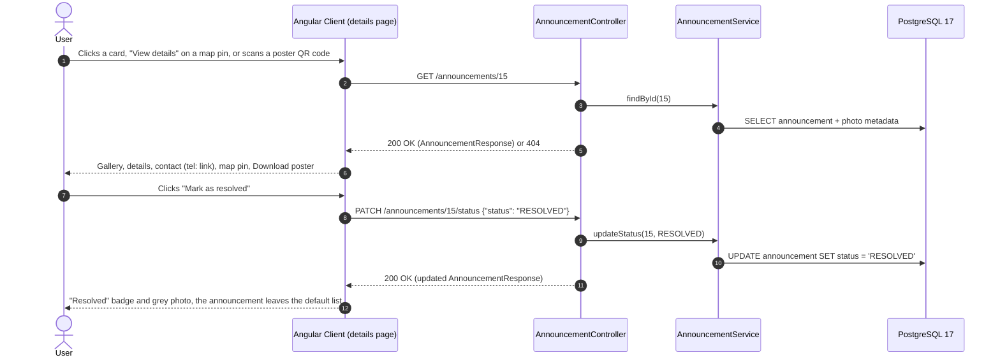
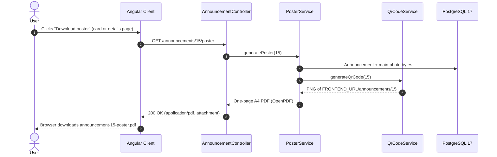

# System Architecture

## 1. System Overview
SafePaws is a collaborative web-based platform designed to assist pet owners and communities in tracking, reporting, and reuniting lost and found pets.

---

## 2. High-Level Architecture
The system follows a decoupled client-server multi-tier architecture:
- **Client Tier:** Angular 22 Single Page Application (SPA) communicating via RESTful JSON over HTTP. Maps use Leaflet with OpenStreetMap tiles, loaded by the browser directly from OpenStreetMap.
- **Application Tier:** Spring Boot REST API handling business logic, validation, transaction management, OpenAPI documentation, and the printable PDF posters with a QR code (OpenPDF and ZXing).
- **Persistence Tier:** PostgreSQL 17 database containerized via Docker Compose, managed via Spring Data JPA, Hibernate, and Flyway.

---

## 3. Component Communication & Tier Architecture

The diagram below illustrates the end-to-end communication flow across all system tiers:



---

## 4. End-to-End Data Flow Scenarios

### Scenario 1: Listing and Filtering Announcements


*Key Characteristics:*
- Without query parameters the backend returns only `ACTIVE` announcements, newest `eventDate` first. Filters, distance and sorting are all done by the backend; the pages show the results in the order received.
- Raw image bytes (`BYTEA`), longer details (`breed`, `color`, `distinctiveMarks`) and contact details are omitted from `GET /announcements`. Images are loaded on demand via `/photos/{id}`.
- The list page and the map page each provide their own `AnnouncementSearch` instance, which reads the filters from the URL, asks the browser for the location when a radius or "Closest first" needs it, and calls the backend.

---

### Scenario 2: Uploading Announcement & Attached Photos


---

### Scenario 3: Viewing an Announcement and Marking It as Resolved


*Key Characteristics:*
- The page shows the announcement returned by the backend, so the "Resolved" badge only appears once the change is saved. The button is disabled while the request is running.
- An id that is not a positive whole number shows "Announcement not found" without calling the backend.

---

### Scenario 4: Downloading a Poster


*Key Characteristics:*
- The poster is generated on every request, so it always shows the current status (a resolved announcement gets a `RESOLVED` badge and a grey photo).
- The QR code points to `FRONTEND_URL` from `.env`, so it can be scanned from a phone only when that is the laptop's IP (see `usage-guide.md`).

---

## 5. Repository & Module Structure

The project structure cleanly separates client, server, database migrations, and documentation:

```text
safepaws/
├── .github/workflows/ci.yml              # CI: tests + coverage, secret scan, migration guard
├── backend/                              # Spring Boot 4.1 (Java 21)
│   ├── src/main/java/
│   │   ├── com/ninelives/safepaws/
│   │   │   ├── controller/               # REST endpoints (AnnouncementController, PhotoController)
│   │   │   ├── service/                  # Business logic (AnnouncementService, PhotoService, PosterService, QrCodeService, AuthService, JwtService)
│   │   │   ├── repository/               # Spring Data JPA repositories, AnnouncementSpecifications (filters), PhotoMetadata
│   │   │   ├── model/                    # JPA entities (Announcement, Photo) and enums
│   │   │   ├── dto/                      # Request/response records, AnnouncementFilter, ErrorResponse
│   │   │   ├── exception/                # GlobalExceptionHandler and custom exceptions
│   │   │   └── config/                   # CorsConfig, SecurityConfig, JwtAuthenticationFilter, PasswordConfig
│   │   └── db/migration/                 # Java Flyway migrations (V4__Seed_demo_photos)
│   ├── src/main/resources/
│   │   ├── application.properties        # Application configuration & .env import
│   │   ├── db/migration/                 # SQL Flyway migrations (V1, V2, V3, V5)
│   │   ├── db/demo-photos/               # Demo images loaded by V4 (sources in SOURCES.md)
│   │   └── fonts/                        # DejaVu Sans and DejaVu Sans Bold, used by the PDF poster (Romanian diacritics)
│   └── src/test/                         # Tests mirroring src/main (JUnit 5, Mockito, Testcontainers)
├── frontend/                             # Angular 22 SPA
│   └── src/
│       ├── app/
│       │   ├── pages/                    # announcement-list, announcement-form, announcement-details, map-page
│       │   ├── components/               # header, announcement-card, announcement-popup, filter-bar, map
│       │   ├── services/                 # AnnouncementService (HTTP), LocationService (browser location), AnnouncementSearch
│       │   ├── models/                   # Types: Announcement, Photo, filters and labels, MapPin, Coordinates
│       │   └── shared/                   # Leaflet icon helper, DATE_FORMAT (one date format for the app)
│       ├── environments/                 # Backend API base URL (same host the page was opened from, port 8080)
│       └── styles.css                    # Global styles and the CSS variables (colors, shadows, corners)
├── docs/                                 # Project documentation
├── docker-compose.yml                    # Starts the PostgreSQL 17 database
└── README.md                             # Project overview
```

---

## 6. Infrastructure & Quality Pipeline

### Frontend Styling
- Every color, shadow and corner radius is a CSS variable in `frontend/src/styles.css`, named by its role (`--color-primary`, `--color-text-muted`, `--color-error`, `--radius-control`...). Components use them with `var(--name)`, never hex codes (ADR 012 in `decisions.md`).
- Dates are shown with `DATE_FORMAT` (`shared/date-format.ts`), and types and species with `TYPE_LABELS` and `SPECIES_LABELS`.
- Below 600px wide the layout switches to one column (header tabs on one row, filters in two columns).

### Configuration & Phone Access
- Values that differ between machines come from `.env` (ADR 013): the database settings, `CORS_ALLOWED_ORIGINS` and `FRONTEND_URL` (the address in the poster QR code).
- The frontend calls the backend on port 8080 of the host it was opened from, so the app also works from a phone on the same Wi-Fi when opened at the laptop's IP.

### Cross-Origin Resource Sharing (CORS)
- Handled by `CorsConfig` allowing origins configured via `CORS_ALLOWED_ORIGINS` (defaulting to `http://localhost:4200`).
- Supports methods `GET, POST, PUT, PATCH, DELETE, OPTIONS`, allows all headers, and exposes the `Location` header so clients can retrieve newly created resource URLs.

### Interactive API Documentation
- Powered by `springdoc-openapi-starter-webmvc-ui` (v3.1.1).
- Interactive Swagger UI: `http://localhost:8080/swagger-ui.html`
- OpenAPI Specification: `http://localhost:8080/v3/api-docs`

### CI/CD Automation (GitHub Actions)
Continuous integration is configured under `.github/workflows/ci.yml` and triggers on pushes and PRs to `main`:
1. **Backend Verification:** Uses Temurin JDK 21, executes `./mvnw verify` with Testcontainers starting a real PostgreSQL container, and checks that JaCoCo instruction coverage is >= 70%.
2. **Frontend Verification:** Uses Node 22, installs dependencies via `npm ci`, runs tests with Vitest (`npm run test:coverage`), checks statement/branch/function/line coverage >= 70%, and performs a production build (`npm run build`).
3. **Secret Scan:** Scans commit diffs with Gitleaks (v8.21.2) to prevent accidental credential commits.
4. **Migration Guard:** Validates that Flyway migrations on `main` are immutable, version numbers are unique, and new migrations contain no destructive DDL unless explicitly marked `[destructive]` in the PR title.

---

## 7. Authentication & Authorization
User accounts with JWT login (ADR 014 in `decisions.md`; endpoints and errors in `api.md`).

### How it works today
- **Accounts:** `POST /auth/register` creates a user in the `users` table (`V6`). The email is trimmed and saved in lowercase; the password is stored only as a BCrypt hash (`PasswordConfig`). Three demo accounts are seeded by `V6` (see the root `README.md`).
- **Login:** `POST /auth/login` checks the password and returns a JWT from `JwtService`: HS256, signed with `JWT_SECRET` (`.env`), with the user id as subject, valid for 24 hours. The server keeps no session (`SessionCreationPolicy.STATELESS`), so restarting the backend does not log anyone out, and a token cannot be revoked before it expires.
- **Requests:** `JwtAuthenticationFilter` reads `Authorization: Bearer <token>`. A valid token makes the user id the authenticated principal; an invalid or expired token is ignored, so public endpoints still work.
- **Rules (`SecurityConfig`):** public are `POST /auth/register` and `/auth/login`, and `GET` on announcements, photos and posters (also Swagger UI and `/v3/api-docs`). `GET /auth/me`, `POST /announcements`, `PUT /announcements/{id}`, `PATCH /announcements/{id}/status` and `POST /announcements/{id}/photos` need a valid token, otherwise `401 Authentication is required`. CSRF is disabled (no cookies are used) and CORS uses `CorsConfig`.
- **Frontend:** `AuthService` keeps the token, its expiry and the user in the browser's local storage, and logs the user out when the token expires. `authInterceptor` adds the `Authorization` header to every backend request; when the backend answers `401` to a request that had a token, the user is sent to `/login` with the page they were on as `returnUrl`. The header shows **Post announcement**, the display name and **Log out** only when logged in. Route guards (`auth.guards.ts`): `loggedInGuard` sends a guest who opens `/announcements/new` to `/login` with that page as `returnUrl`; `guestGuard` sends a logged-in user who opens `/login` or `/register` to `/announcements`.
- **Owner check:** `AnnouncementOwnershipService.requireOwner()` lets only the owner edit an announcement, change its status or add photos; another user gets `403 Forbidden` (`You can only change your own announcements`). Checks run in the order `401`, `400`, `404`, `403`. `POST /announcements` saves the logged-in user as the owner, and `V8` makes `owner_id` required.
- **`ownerId`** is in the responses of `GET /announcements/{id}`, `POST`, `PUT` and `PATCH` (not in the list), so the details page shows **Mark as resolved** / **Mark as active** only to the owner.
- The reporter's contact details (`contact_name`, `contact_phone`) are still stored on the announcement and returned by `GET /announcements/{id}`.

### Planned, not on main yet
- **Edit page** in the frontend, using `PUT /announcements/{id}`.
