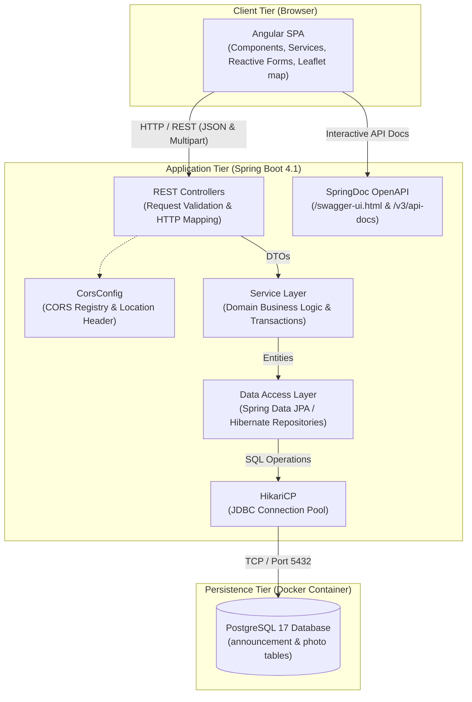
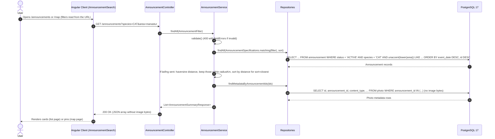
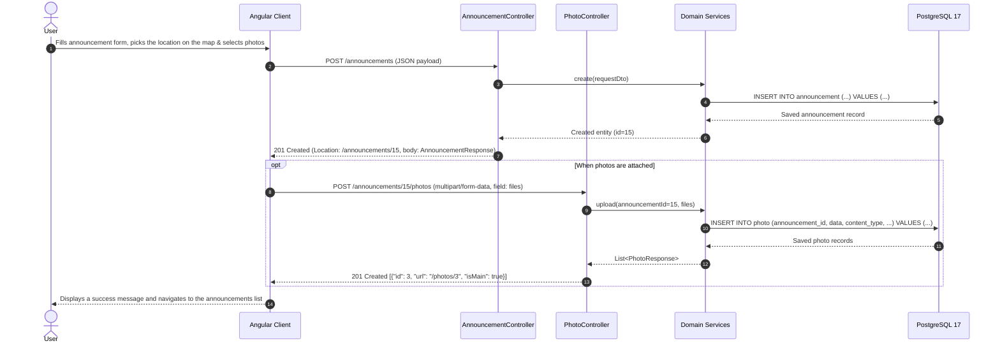

# System Architecture

## 1. System Overview
SafePaws is a collaborative web-based platform designed to assist pet owners and communities in tracking, reporting, and reuniting lost and found pets.

---

## 2. High-Level Architecture
The system follows a decoupled client-server multi-tier architecture:
- **Client Tier:** Angular 22 Single Page Application (SPA) communicating via RESTful JSON over HTTP. Maps use Leaflet with OpenStreetMap tiles, loaded by the browser directly from OpenStreetMap.
- **Application Tier:** Spring Boot REST API handling business logic, validation, transaction management, and OpenAPI documentation.
- **Persistence Tier:** PostgreSQL 17 database containerized via Docker Compose, managed via Spring Data JPA, Hibernate, and Flyway.

---

## 3. Component Communication & Tier Architecture

The diagram below illustrates the end-to-end communication flow across all system tiers:



---

## 4. End-to-End Data Flow Scenarios

### Scenario 1: Listing and Filtering Announcements


*Key Characteristics:*
- Without query parameters the backend returns only `ACTIVE` announcements, newest `eventDate` first. Filters, distance and sorting are all done by the backend; the pages show the results in the order received.
- Raw image bytes (`BYTEA`), longer details (`breed`, `color`, `distinctiveMarks`) and contact details are omitted from `GET /announcements`. Images are loaded on demand via `/photos/{id}`.
- The list page and the map page each provide their own `AnnouncementSearch` instance, which reads the filters from the URL, asks the browser for the location when a radius or "Closest first" needs it, and calls the backend.

---

### Scenario 2: Uploading Announcement & Attached Photos


---

## 5. Repository & Module Structure

The project structure cleanly separates client, server, database migrations, and documentation:

```text
safepaws/
├── .github/workflows/ci.yml              # CI: tests + coverage, secret scan, migration guard
├── backend/                              # Spring Boot 4.1 (Java 21)
│   ├── src/main/java/
│   │   ├── com/ninelives/safepaws/
│   │   │   ├── controller/               # REST endpoints (AnnouncementController, PhotoController)
│   │   │   ├── service/                  # Business logic (AnnouncementService, PhotoService, PosterService)
│   │   │   ├── repository/               # Spring Data JPA repositories, AnnouncementSpecifications (filters), PhotoMetadata
│   │   │   ├── model/                    # JPA entities (Announcement, Photo) and enums
│   │   │   ├── dto/                      # Request/response records, AnnouncementFilter, ErrorResponse
│   │   │   ├── exception/                # GlobalExceptionHandler and custom exceptions
│   │   │   └── config/                   # CorsConfig
│   │   └── db/migration/                 # Java Flyway migrations (V4__Seed_demo_photos)
│   ├── src/main/resources/
│   │   ├── application.properties        # Application configuration & .env import
│   │   ├── db/migration/                 # SQL Flyway migrations (V1, V2, V3, V5)
│   │   ├── db/demo-photos/               # Demo images loaded by V4 (sources in SOURCES.md)
│   │   └── fonts/                        # DejaVu Sans Bold, used by the PDF poster (Romanian diacritics)
│   └── src/test/                         # Tests mirroring src/main (JUnit 5, Mockito, Testcontainers)
├── frontend/                             # Angular 22 SPA
│   └── src/
│       ├── app/
│       │   ├── pages/                    # announcement-list, announcement-form, map-page
│       │   ├── components/               # header, announcement-card, announcement-popup, filter-bar, map
│       │   ├── services/                 # AnnouncementService (HTTP), LocationService (browser location), AnnouncementSearch
│       │   ├── models/                   # Types: Announcement, Photo, filters, MapPin, Coordinates
│       │   └── shared/                   # Leaflet icon helper
│       └── environments/                 # Backend API base URL configuration
├── docs/                                 # Project documentation
├── docker-compose.yml                    # Starts the PostgreSQL 17 database
└── README.md                             # Project overview
```

---

## 6. Infrastructure & Quality Pipeline

### Cross-Origin Resource Sharing (CORS)
- Handled by `CorsConfig` allowing origins configured via `CORS_ALLOWED_ORIGINS` (defaulting to `http://localhost:4200`).
- Supports methods `GET, POST, PUT, PATCH, DELETE, OPTIONS`, allows all headers, and exposes the `Location` header so clients can retrieve newly created resource URLs.

### Interactive API Documentation
- Powered by `springdoc-openapi-starter-webmvc-ui` (v3.1.1).
- Interactive Swagger UI: `http://localhost:8080/swagger-ui.html`
- OpenAPI Specification: `http://localhost:8080/v3/api-docs`

### CI/CD Automation (GitHub Actions)
Continuous integration is configured under `.github/workflows/ci.yml` and triggers on pushes and PRs to `main`:
1. **Backend Verification:** Uses Temurin JDK 21, executes `./mvnw verify` with Testcontainers starting a real PostgreSQL container, and checks that JaCoCo instruction coverage is >= 70%.
2. **Frontend Verification:** Uses Node 22, installs dependencies via `npm ci`, runs tests with Vitest (`npm run test:coverage`), checks statement/branch/function/line coverage >= 70%, and performs a production build (`npm run build`).
3. **Secret Scan:** Scans commit diffs with Gitleaks (v8.21.2) to prevent accidental credential commits.
4. **Migration Guard:** Validates that Flyway migrations on `main` are immutable, version numbers are unique, and new migrations contain no destructive DDL unless explicitly marked `[destructive]` in the PR title.

---

## 7. Authentication & Authorization
There is currently no authentication or authorization. All endpoints are public: anyone can create announcements, upload photos and read every announcement, including the contact details returned by `GET /announcements/{id}`. The reporter's contact details are stored directly on the announcement.
