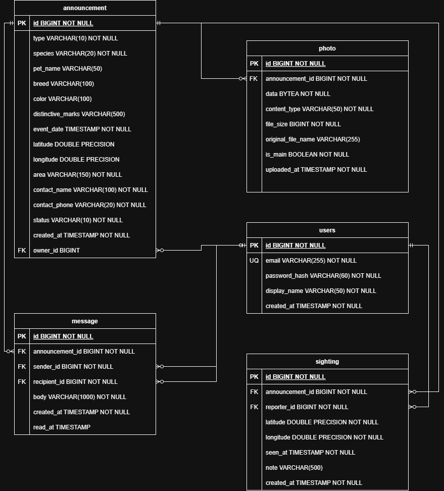

# Database Design & Schema

## 1. Overview & Technology Stack
SafePaws uses **PostgreSQL 17**, containerized via Docker Compose. Schema migrations and seed data are managed automatically on backend startup using **Flyway**. SQL migrations are in `backend/src/main/resources/db/migration`, and Java migrations are in `backend/src/main/java/db/migration`. Both share one version sequence.

### Migration Ledger
| Migration | Description |
|---|---|
| `V1__create_tables.sql` | Initializes the core `announcement` and `photo` tables with strict constraints, indexes, and foreign keys. |
| `V2__test_data.sql` | Seeds 14 fictional test announcements in and around Cluj-Napoca, with 2 photos (Mitzi, photo id 1, and Rex, photo id 2). |
| `V3__search_support.sql` | Enables the `unaccent` extension (diacritic-insensitive search), adds indexes on `type`, `species` and `status`, gives every V2 announcement coordinates, changes every area to the "Neighborhood, City" format, and adds 8 announcements in other cities (22 in total). |
| `V4__Seed_demo_photos.java` | Java migration that loads 23 demo photos from `backend/src/main/resources/db/demo-photos/` (CC0 images from Wikimedia Commons, sources in `SOURCES.md` there), so every announcement has a main photo (25 photos in total). |
| `V5__complete_demo_data.sql` | Completes the demo announcements (breed, color, distinctive marks) so each description matches its photo. |
| `V6__users_and_owners.sql` | Adds the `users` table and `announcement.owner_id` (ADR 014), creates the 3 demo accounts and shares the 22 demo announcements between them. |
| `V7__messages_and_sightings.sql` | Adds the `message` table (messages about an announcement between two users) and the `sighting` table ("I saw it here" points for the map trail). |

Test announcements are matched across migrations by their fictional placeholder phone numbers (`0700000001`–`0700000022`), not by ID. The dates of the V3 announcements are relative to when the migration runs, so they are always recent.

On a fresh database: 22 announcements (12 LOST, 10 FOUND; 18 ACTIVE, 4 RESOLVED; 10 without a pet name; all with coordinates), 25 photos and 3 users. Announcements 9, 13 and 21 have 2 photos each. There are no messages or sightings.

### Demo accounts (V6)
All three use the password `SafePaws1!`. It is stored only as a BCrypt hash; the password itself is public, for the demo.

| Email | Display name | Owns announcements | Resolved | With 2 photos |
|---|---|---|---|---|
| `ana@safepaws.dev` | Ana Pop | 1, 4, 7, 10, 13, 16, 19, 22 | 10 | 13 |
| `mihai@safepaws.dev` | Mihai Rus | 2, 8, 9, 11, 12, 17, 20 | 12 | 9 |
| `elena@safepaws.dev` | Elena Moldovan | 3, 5, 6, 14, 15, 18, 21 | 6, 21 | 21 |

The numbers are the last digits of the placeholder phone, which match the ids on a fresh database. Every account owns LOST and FOUND, active and resolved announcements, so each one can be used to test the owner rules.

---

## 2. Entity-Relationship Model

Below is the conceptual and physical ER diagram:



### Relationships
- **Announcement to Photos (`1 : N`):** An announcement can have zero or multiple photos; each photo belongs to exactly one announcement.
- **User to Announcements (`1 : N`):** A user owns zero or more announcements; each announcement has one owner (`announcement.owner_id`). The column is nullable until `V8` makes it required.
- **Announcement to Messages (`1 : N`):** Every message is about one announcement and goes from one user (`sender_id`) to another (`recipient_id`). A conversation is all the messages about one announcement between the same two users.
- **Announcement to Sightings (`1 : N`):** Every sighting belongs to one announcement and was reported by one user (`reporter_id`).
- **Cascade Deletion:** `ON DELETE CASCADE` is enforced on `photo.announcement_id`, `message.announcement_id` and `sighting.announcement_id`. Deleting an announcement automatically deletes its photos, messages and sightings. Users are never deleted in cascade: a user who still owns announcements, messages or sightings cannot be deleted.

---

## 3. Table Definitions

### Table: `announcement`
Stores lost and found pet reports.

| Column | Type | Required | Constraints / Default | Description |
|---|---|---|---|---|
| `id` | `BIGINT` | Yes | `GENERATED ALWAYS AS IDENTITY PRIMARY KEY` | Unique identifier. |
| `type` | `VARCHAR(10)` | Yes | `CHECK (type IN ('LOST', 'FOUND'))` | Announcement category. |
| `species` | `VARCHAR(20)` | Yes | `CHECK (species IN ('CAT', 'DOG', 'OTHER'))` | Animal species. |
| `pet_name` | `VARCHAR(50)` | No | — | Name of the pet (if known). |
| `breed` | `VARCHAR(100)` | No | — | Pet breed. |
| `color` | `VARCHAR(100)` | No | — | Distinctive pet coloration. |
| `distinctive_marks` | `VARCHAR(500)` | No | — | Scars, collar details, markings. |
| `event_date` | `TIMESTAMP` | Yes | — | Date/time the pet was lost or found. |
| `latitude` | `DOUBLE PRECISION`| No | Range: `[-90, 90]` | Coordinate latitude (set together with longitude). |
| `longitude` | `DOUBLE PRECISION`| No | Range: `[-180, 180]` | Coordinate longitude (set together with latitude). |
| `area` | `VARCHAR(150)` | Yes | — | "Neighborhood, City" (e.g., "Mănăștur, Cluj-Napoca"). |
| `contact_name` | `VARCHAR(100)` | Yes | — | Name of contact person. |
| `contact_phone` | `VARCHAR(20)` | Yes | Stored as text | Phone number (preserves leading `0` / `+40`). |
| `status` | `VARCHAR(10)` | Yes | `CHECK (status IN ('ACTIVE', 'RESOLVED'))`, Default: `'ACTIVE'` | Current status of the report. Changed with `PATCH /announcements/{id}/status` ("Mark as resolved" / "Mark as active" on the details page). |
| `created_at` | `TIMESTAMP` | Yes | Default: `CURRENT_TIMESTAMP` | Record creation timestamp. |
| `owner_id` | `BIGINT` | No (until `V8`) | `FOREIGN KEY` references `users(id)` | The user who posted the announcement (`ownerId` in the API). Added in V6. |

---

### Table: `users`
Stores user accounts (ADR 014). The name is plural because `user` is a reserved word in PostgreSQL.

| Column | Type | Required | Constraints / Default | Description |
|---|---|---|---|---|
| `id` | `BIGINT` | Yes | `GENERATED ALWAYS AS IDENTITY PRIMARY KEY` | Unique identifier, kept in the JWT. |
| `email` | `VARCHAR(255)` | Yes | `UNIQUE`, `CHECK (email = lower(btrim(email)))` | Login email, saved trimmed and in lowercase by the backend. |
| `password_hash` | `VARCHAR(60)` | Yes | — | BCrypt hash (`$2a$10$...`, 60 characters). The password itself is never stored or returned. |
| `display_name` | `VARCHAR(50)` | Yes | Not blank | Name shown in the app. |
| `created_at` | `TIMESTAMP` | Yes | Default: `CURRENT_TIMESTAMP` | Registration timestamp. |

---

### Table: `message`
Messages about an announcement between two users, so they can talk without a public phone number. Added in V7.

| Column | Type | Required | Constraints / Default | Description |
|---|---|---|---|---|
| `id` | `BIGINT` | Yes | `GENERATED ALWAYS AS IDENTITY PRIMARY KEY` | Unique identifier. |
| `announcement_id` | `BIGINT` | Yes | `FOREIGN KEY` references `announcement(id)` `ON DELETE CASCADE` | The announcement the message is about. |
| `sender_id` | `BIGINT` | Yes | `FOREIGN KEY` references `users(id)` | Who wrote it. |
| `recipient_id` | `BIGINT` | Yes | `FOREIGN KEY` references `users(id)`, different from `sender_id` | Who receives it. |
| `body` | `VARCHAR(1000)` | Yes | Not blank | The message text. |
| `created_at` | `TIMESTAMP` | Yes | Default: `CURRENT_TIMESTAMP` | When it was sent. |
| `read_at` | `TIMESTAMP` | No | — | When the recipient opened it; empty means unread. |

---

### Table: `sighting`
"I saw it here" reports, shown on the map as a trail. Added in V7.

| Column | Type | Required | Constraints / Default | Description |
|---|---|---|---|---|
| `id` | `BIGINT` | Yes | `GENERATED ALWAYS AS IDENTITY PRIMARY KEY` | Unique identifier. |
| `announcement_id` | `BIGINT` | Yes | `FOREIGN KEY` references `announcement(id)` `ON DELETE CASCADE` | The pet that was seen. |
| `reporter_id` | `BIGINT` | Yes | `FOREIGN KEY` references `users(id)` | Who reported it. |
| `latitude` | `DOUBLE PRECISION` | Yes | Range: `[-90, 90]` | Where the pet was seen. |
| `longitude` | `DOUBLE PRECISION` | Yes | Range: `[-180, 180]` | Where the pet was seen. |
| `seen_at` | `TIMESTAMP` | Yes | — | When the pet was seen (can be earlier than `created_at`). |
| `note` | `VARCHAR(500)` | No | — | Optional details ("ran towards the park"). |
| `created_at` | `TIMESTAMP` | Yes | Default: `CURRENT_TIMESTAMP` | When the sighting was reported. |

---

### Table: `photo`
Stores binary image data attached to announcements.

| Column | Type | Required | Constraints / Default | Description |
|---|---|---|---|---|
| `id` | `BIGINT` | Yes | `GENERATED ALWAYS AS IDENTITY PRIMARY KEY` | Unique identifier. |
| `announcement_id`| `BIGINT` | Yes | `FOREIGN KEY` references `announcement(id)` `ON DELETE CASCADE` | Associated announcement ID. |
| `data` | `BYTEA` | Yes | — | Raw binary image payload. |
| `content_type` | `VARCHAR(50)` | Yes | `CHECK (content_type IN ('image/jpeg', 'image/png'))` | MIME type of the uploaded file. |
| `file_size` | `BIGINT` | Yes | `CHECK (file_size > 0)` (in bytes) | Total image size. |
| `original_file_name` | `VARCHAR(255)`| No | — | Original upload filename. |
| `is_main` | `BOOLEAN` | Yes | Default: `false` | Primary photo flag (at most one per announcement via unique index). |
| `uploaded_at` | `TIMESTAMP` | Yes | Default: `CURRENT_TIMESTAMP` | Upload timestamp. |

### Indexes & Extensions
| Name | Definition | Added in | Purpose |
|---|---|---|---|
| `idx_announcement_created_at` | `announcement (created_at DESC)` | V1 | Index on creation time (the list is ordered by `event_date`, not by `created_at`). |
| `idx_announcement_type` | `announcement (type)` | V3 | List filter. |
| `idx_announcement_species` | `announcement (species)` | V3 | List filter. |
| `idx_announcement_status` | `announcement (status)` | V3 | List filter (the list returns only `ACTIVE` by default). |
| `idx_photo_announcement_id` | `photo (announcement_id)` | V1 | Loading the photos of announcements. |
| `uq_photo_main_per_announcement` | `UNIQUE photo (announcement_id) WHERE is_main` | V1 | At most one main photo per announcement. |
| `uq_users_email` | `UNIQUE users (email)` | V6 | One account per email; also used by login. |
| `idx_announcement_owner_id` | `announcement (owner_id)` | V6 | The announcements of a user, and the owner foreign key. |
| `idx_message_announcement_id` | `message (announcement_id, created_at)` | V7 | The messages of an announcement, in order. |
| `idx_message_sender_id` | `message (sender_id)` | V7 | Sent messages, and the sender foreign key. |
| `idx_message_recipient_id` | `message (recipient_id, created_at DESC)` | V7 | A user's inbox, newest first, and unread counts. |
| `idx_sighting_announcement_id` | `sighting (announcement_id, seen_at)` | V7 | The trail of an announcement, in the order the pet was seen. |
| `idx_sighting_reporter_id` | `sighting (reporter_id)` | V7 | The reporter foreign key. |
| extension `unaccent` | `CREATE EXTENSION IF NOT EXISTS unaccent` | V3 | Case- and diacritic-insensitive text filters (`color`, `breed`, `area`). `unaccent` is not `IMMUTABLE`, so it is not indexed. |

---

## 4. Architectural & Schema Decisions

- **Users and owners (DEMO 2, ADR 014):** every announcement belongs to the user who posted it (`owner_id`). The contact name and phone still stay on the announcement, so they can differ from the owner's display name. `owner_id` is nullable in `V6` so that posting keeps working until the backend sets the owner; `V8` makes it required.
- **Demo passwords:** the demo accounts are created in `V6` with ready-made BCrypt hashes (cost 10, one hash per account), so no password is stored in plain text. The backend checks them with Spring's `BCryptPasswordEncoder`.
- **No Locations Table:** The location (`area`, `latitude`, `longitude`) is stored as columns on the announcement.
- **Binary Image Storage (`BYTEA`):** Images are stored directly in PostgreSQL (see ADR 007 in `decisions.md`). Listing endpoints (`GET /announcements`) load only photo metadata, never the image bytes; individual photos are retrieved via `GET /photos/{id}`.
- **Optional Coordinates:** In the database and the API, coordinates are optional and `area` is mandatory. If coordinates are provided, both latitude and longitude must be present together (`ck_announcement_coordinates`). The frontend form requires the user to pick a location on the map, but announcements created directly through the API can have no coordinates; they are left out of location searches and the map.
- **Conventions & Immutability:** 
  - Database schema uses strict `snake_case` (`contact_phone`, `pet_name`), mapping directly to `camelCase` in Java DTOs/Entities (`contactPhone`, `petName`).
  - Fixed domain attributes (`type`, `species`, `status`) use uppercase `VARCHAR` with SQL `CHECK` constraints to map cleanly to Spring Boot Java Enums.
  - Merged Flyway migrations must never be altered. Any subsequent schema updates must be introduced via a new migration; the next version is `V8`. SQL and Java migrations share version numbers, and the CI migration guard only checks SQL files, so check Java migrations by hand.

---

## 5. How to Run & Connect to PostgreSQL

### Local Setup
1. **Environment Configuration:**
   Copy the environment template:
   ```bash
   cp .env.example .env
   ```
   > **Note:** `.env` is ignored by Git and must never be committed.

2. **Start Database Container:**
   ```bash
   docker compose up -d
   ```

3. **Health Check:**
   Confirm that the container is healthy:
   ```bash
   docker compose ps
   ```
   *(The `STATUS` column should indicate `healthy`).*

4. **Launch Backend:**
   Start the Spring Boot backend (`./mvnw spring-boot:run`). Flyway will automatically execute migrations and load seed data on startup.

### Connection Credentials
For GUI clients (IntelliJ Database Tool, DBeaver, pgAdmin) or direct connections:
- **Host:** `localhost`
- **Port:** `5432` *(or `5433` if fallback `DB_PORT=5433` is configured)*
- **Database:** `safepaws`
- **User:** `safepaws`
- **Password:** Configured in your local `.env` file (`DB_PASSWORD`)

### Lifecycle Commands
| Task | Command | Description |
|---|---|---|
| **Stop Database (Retain Data)** | `docker compose down` | Stops containers while preserving database volume data. |
| **Reset Database (Wipe & Re-seed)** | `docker compose down -v` | Wipes the volume data; Flyway recreates tables and seeds data on the next backend boot. Do this on the demo laptop shortly before a demo, so the demo dates are recent and anything added by hand is removed. |
| **Port Conflict Resolution** | Set `DB_PORT=5433` in `.env` | Use when local PostgreSQL is already occupying port `5432`. |