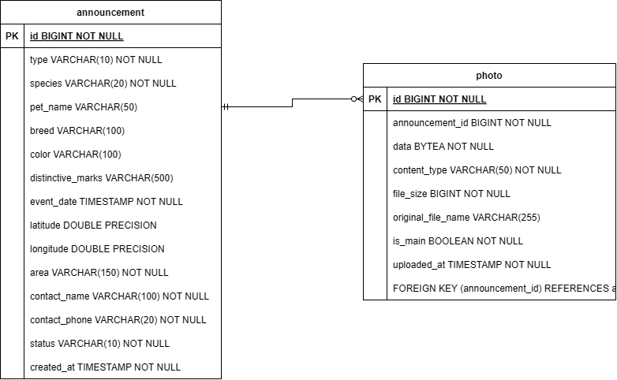

# Database Design & Schema

## 1. Overview & Technology Stack
SafePaws uses **PostgreSQL 17**, containerized via Docker Compose. Schema migrations and seed data are managed automatically on backend startup using **Flyway**. SQL migrations are in `backend/src/main/resources/db/migration`, and Java migrations are in `backend/src/main/java/db/migration`. Both share one version sequence.

### Migration Ledger
| Migration | Description |
|---|---|
| `V1__create_tables.sql` | Initializes the core `announcement` and `photo` tables with strict constraints, indexes, and foreign keys. |
| `V2__test_data.sql` | Seeds 14 fictional test announcements in and around Cluj-Napoca, with 2 photos (Mitzi, photo id 1, and Rex, photo id 2). |
| `V3__search_support.sql` | Enables the `unaccent` extension (diacritic-insensitive search), adds indexes on `type`, `species` and `status`, gives every V2 announcement coordinates, changes every area to the "Neighborhood, City" format, and adds 8 announcements in other cities (22 in total). |
| `V4__Seed_demo_photos.java` | Java migration that loads 23 demo photos from `backend/src/main/resources/db/demo-photos/` (CC0 images from Wikimedia Commons, sources in `SOURCES.md` there), so every announcement has a main photo (25 photos in total). |
| `V5__complete_demo_data.sql` | Completes the demo announcements (breed, color, distinctive marks) so each description matches its photo. |

Test announcements are matched across migrations by their fictional placeholder phone numbers (`0700000001`–`0700000022`), not by ID. The dates of the V3 announcements are relative to when the migration runs, so they are always recent.

On a fresh database: 22 announcements (12 LOST, 10 FOUND; 18 ACTIVE, 4 RESOLVED; 10 without a pet name; all with coordinates) and 25 photos. Announcements 9, 13 and 21 have 2 photos each.

---

## 2. Entity-Relationship Model

Below is the conceptual and physical ER diagram:



### Relationships
- **Announcement to Photos (`1 : N`):** An announcement can have zero or multiple photos; each photo belongs to exactly one announcement.
- **Cascade Deletion:** `ON DELETE CASCADE` is enforced on `photo.announcement_id`. Deleting an announcement automatically deletes all related photo records.

---

## 3. Table Definitions

### Table: `announcement`
Stores lost and found pet reports.

| Column | Type | Required | Constraints / Default | Description |
|---|---|---|---|---|
| `id` | `BIGINT` | Yes | `GENERATED ALWAYS AS IDENTITY PRIMARY KEY` | Unique identifier. |
| `type` | `VARCHAR(10)` | Yes | `CHECK (type IN ('LOST', 'FOUND'))` | Announcement category. |
| `species` | `VARCHAR(20)` | Yes | `CHECK (species IN ('CAT', 'DOG', 'OTHER'))` | Animal species. |
| `pet_name` | `VARCHAR(50)` | No | — | Name of the pet (if known). |
| `breed` | `VARCHAR(100)` | No | — | Pet breed. |
| `color` | `VARCHAR(100)` | No | — | Distinctive pet coloration. |
| `distinctive_marks` | `VARCHAR(500)` | No | — | Scars, collar details, markings. |
| `event_date` | `TIMESTAMP` | Yes | — | Date/time the pet was lost or found. |
| `latitude` | `DOUBLE PRECISION`| No | Range: `[-90, 90]` | Coordinate latitude (set together with longitude). |
| `longitude` | `DOUBLE PRECISION`| No | Range: `[-180, 180]` | Coordinate longitude (set together with latitude). |
| `area` | `VARCHAR(150)` | Yes | — | "Neighborhood, City" (e.g., "Mănăștur, Cluj-Napoca"). |
| `contact_name` | `VARCHAR(100)` | Yes | — | Name of contact person. |
| `contact_phone` | `VARCHAR(20)` | Yes | Stored as text | Phone number (preserves leading `0` / `+40`). |
| `status` | `VARCHAR(10)` | Yes | `CHECK (status IN ('ACTIVE', 'RESOLVED'))`, Default: `'ACTIVE'` | Current status of the report. Changed with `PATCH /announcements/{id}/status` ("Mark as resolved" / "Mark as active" on the details page). |
| `created_at` | `TIMESTAMP` | Yes | Default: `CURRENT_TIMESTAMP` | Record creation timestamp. |

---

### Table: `photo`
Stores binary image data attached to announcements.

| Column | Type | Required | Constraints / Default | Description |
|---|---|---|---|---|
| `id` | `BIGINT` | Yes | `GENERATED ALWAYS AS IDENTITY PRIMARY KEY` | Unique identifier. |
| `announcement_id`| `BIGINT` | Yes | `FOREIGN KEY` references `announcement(id)` `ON DELETE CASCADE` | Associated announcement ID. |
| `data` | `BYTEA` | Yes | — | Raw binary image payload. |
| `content_type` | `VARCHAR(50)` | Yes | `CHECK (content_type IN ('image/jpeg', 'image/png'))` | MIME type of the uploaded file. |
| `file_size` | `BIGINT` | Yes | `CHECK (file_size > 0)` (in bytes) | Total image size. |
| `original_file_name` | `VARCHAR(255)`| No | — | Original upload filename. |
| `is_main` | `BOOLEAN` | Yes | Default: `false` | Primary photo flag (at most one per announcement via unique index). |
| `uploaded_at` | `TIMESTAMP` | Yes | Default: `CURRENT_TIMESTAMP` | Upload timestamp. |

### Indexes & Extensions
| Name | Definition | Added in | Purpose |
|---|---|---|---|
| `idx_announcement_created_at` | `announcement (created_at DESC)` | V1 | Index on creation time (the list is ordered by `event_date`, not by `created_at`). |
| `idx_announcement_type` | `announcement (type)` | V3 | List filter. |
| `idx_announcement_species` | `announcement (species)` | V3 | List filter. |
| `idx_announcement_status` | `announcement (status)` | V3 | List filter (the list returns only `ACTIVE` by default). |
| `idx_photo_announcement_id` | `photo (announcement_id)` | V1 | Loading the photos of announcements. |
| `uq_photo_main_per_announcement` | `UNIQUE photo (announcement_id) WHERE is_main` | V1 | At most one main photo per announcement. |
| extension `unaccent` | `CREATE EXTENSION IF NOT EXISTS unaccent` | V3 | Case- and diacritic-insensitive text filters (`color`, `breed`, `area`). `unaccent` is not `IMMUTABLE`, so it is not indexed. |

---

## 4. Architectural & Schema Decisions

- **No Users / Locations Tables:** There is no authentication in DEMO 1 (see ADR 010 in `decisions.md`), so the reporter's contact information (`contact_name`, `contact_phone`) is stored directly on the announcement. The location (`area`, `latitude`, `longitude`) is also stored as columns on the announcement.
- **Planned for DEMO 2:** user accounts, messages between users and "I saw it here" sightings will need new tables (users, the link between an announcement and its author, messages, sightings), added in new migrations starting from `V6`.
- **Binary Image Storage (`BYTEA`):** Images are stored directly in PostgreSQL (see ADR 007 in `decisions.md`). Listing endpoints (`GET /announcements`) load only photo metadata, never the image bytes; individual photos are retrieved via `GET /photos/{id}`.
- **Optional Coordinates:** In the database and the API, coordinates are optional and `area` is mandatory. If coordinates are provided, both latitude and longitude must be present together (`ck_announcement_coordinates`). The frontend form requires the user to pick a location on the map, but announcements created directly through the API can have no coordinates; they are left out of location searches and the map.
- **Conventions & Immutability:** 
  - Database schema uses strict `snake_case` (`contact_phone`, `pet_name`), mapping directly to `camelCase` in Java DTOs/Entities (`contactPhone`, `petName`).
  - Fixed domain attributes (`type`, `species`, `status`) use uppercase `VARCHAR` with SQL `CHECK` constraints to map cleanly to Spring Boot Java Enums.
  - Merged Flyway migrations must never be altered. Any subsequent schema updates must be introduced via a new migration; the next version is `V6`. SQL and Java migrations share version numbers, and the CI migration guard only checks SQL files, so check Java migrations by hand.

---

## 5. How to Run & Connect to PostgreSQL

### Local Setup
1. **Environment Configuration:**
   Copy the environment template:
   ```bash
   cp .env.example .env
   ```
   > **Note:** `.env` is ignored by Git and must never be committed.

2. **Start Database Container:**
   ```bash
   docker compose up -d
   ```

3. **Health Check:**
   Confirm that the container is healthy:
   ```bash
   docker compose ps
   ```
   *(The `STATUS` column should indicate `healthy`).*

4. **Launch Backend:**
   Start the Spring Boot backend (`./mvnw spring-boot:run`). Flyway will automatically execute migrations and load seed data on startup.

### Connection Credentials
For GUI clients (IntelliJ Database Tool, DBeaver, pgAdmin) or direct connections:
- **Host:** `localhost`
- **Port:** `5432` *(or `5433` if fallback `DB_PORT=5433` is configured)*
- **Database:** `safepaws`
- **User:** `safepaws`
- **Password:** Configured in your local `.env` file (`DB_PASSWORD`)

### Lifecycle Commands
| Task | Command | Description |
|---|---|---|
| **Stop Database (Retain Data)** | `docker compose down` | Stops containers while preserving database volume data. |
| **Reset Database (Wipe & Re-seed)** | `docker compose down -v` | Wipes the volume data; Flyway recreates tables and seeds data on the next backend boot. Do this on the demo laptop shortly before a demo, so the demo dates are recent and anything added by hand is removed. |
| **Port Conflict Resolution** | Set `DB_PORT=5433` in `.env` | Use when local PostgreSQL is already occupying port `5432`. |